# BodyTrack: Manual de Uso
## 1. Criar conta
1. Abra o endereço do app e clique em **Criar conta**.
2. Preencha nome, e-mail, senha (mínimo 6 caracteres) e confirmação.
3. Clique em **Criar conta**. Você entra direto na tela Início.

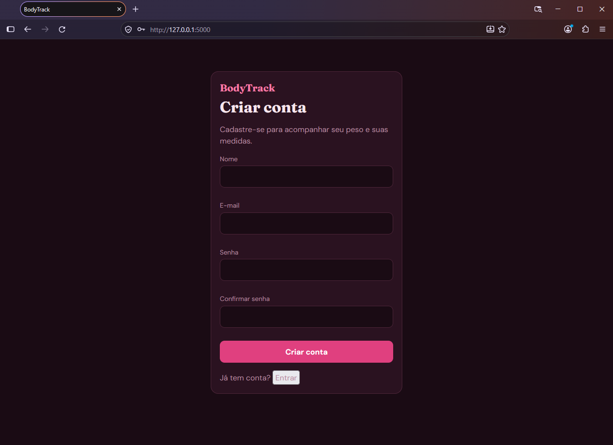
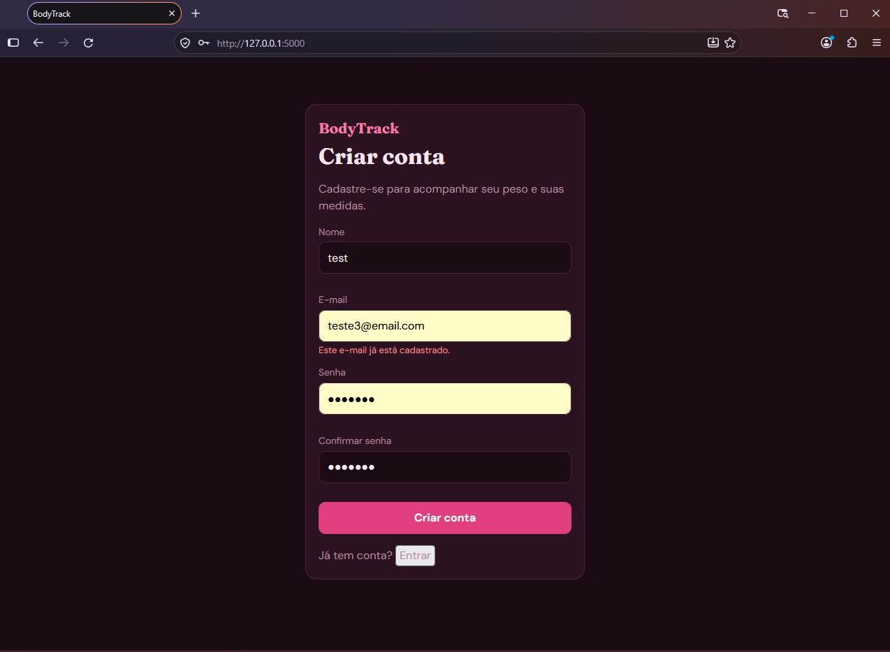

## 2. Entrar e sair
1. Informe e-mail e senha e clique em **Entrar**.
2. Para encerrar, clique em **Sair** (canto superior direito).

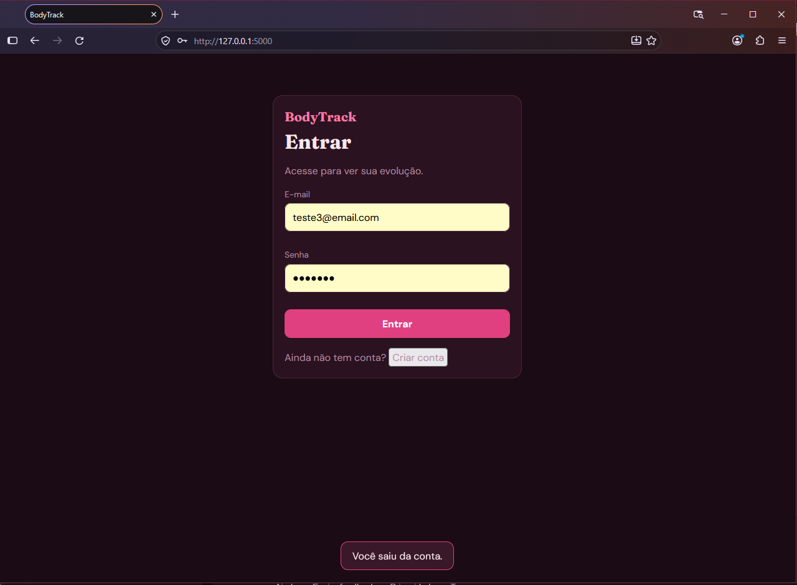
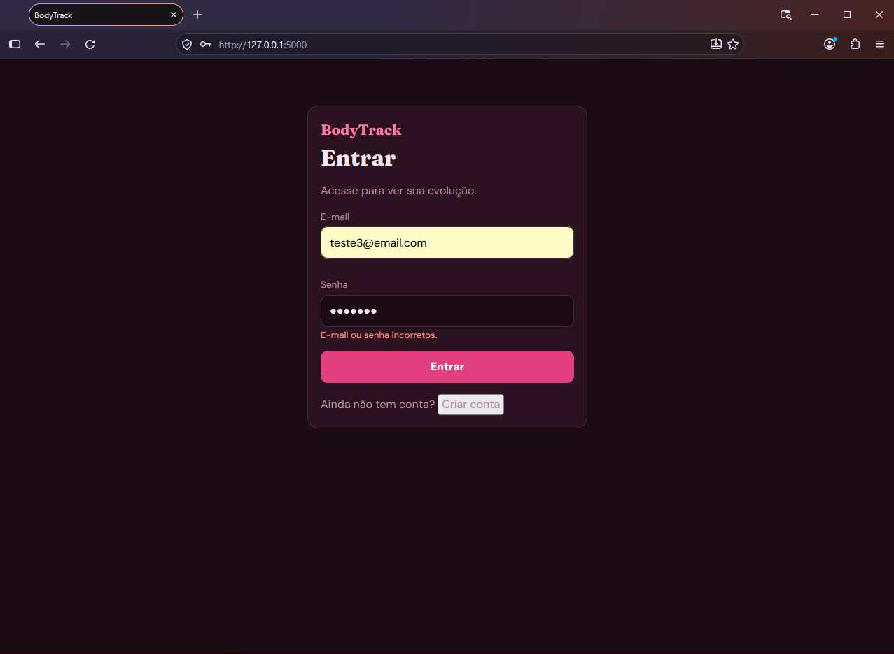

## 3. Registrar peso e medidas
1. Abra a aba **Registrar**.
2. Escolha a data e preencha o peso, a altura e as medidas que quiser. Preencha pelo menos o peso ou uma medida.
3. Clique em **Salvar registro**.

Regras: peso de 20 a 400 kg, altura de 80 a 250 cm, medidas de 10 a 250 cm, data não futura e um registro por data.

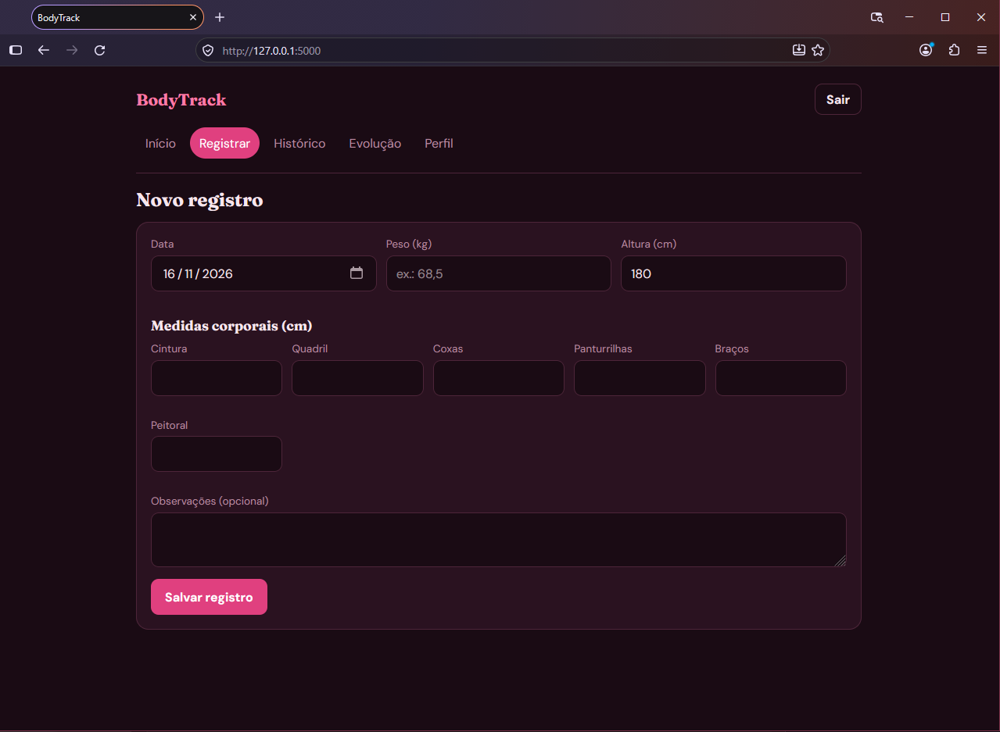
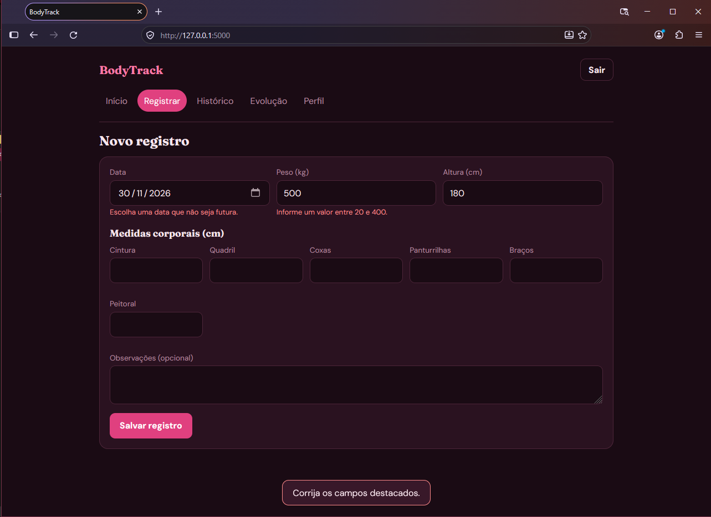

## 4. Histórico
1. Abra a aba **Histórico** para ver todos os registros.
2. Use **De** e **Até** para filtrar por período.
3. **Editar** abre o registro para alterar. **Excluir** pede uma confirmação (clique de novo em "Confirmar?").

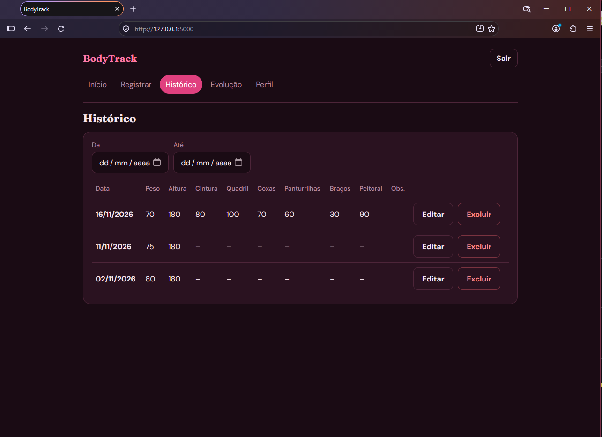

## 5. Evolução
1. Abra a aba **Evolução** e escolha a métrica (peso, altura ou uma medida).
2. Em **Comparar datas**, escolha duas datas para ver a diferença de cada item.

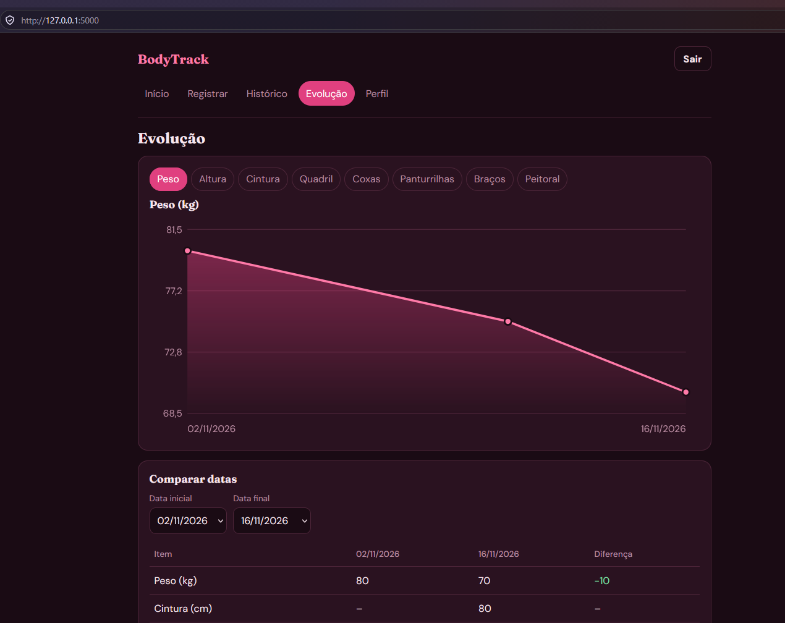
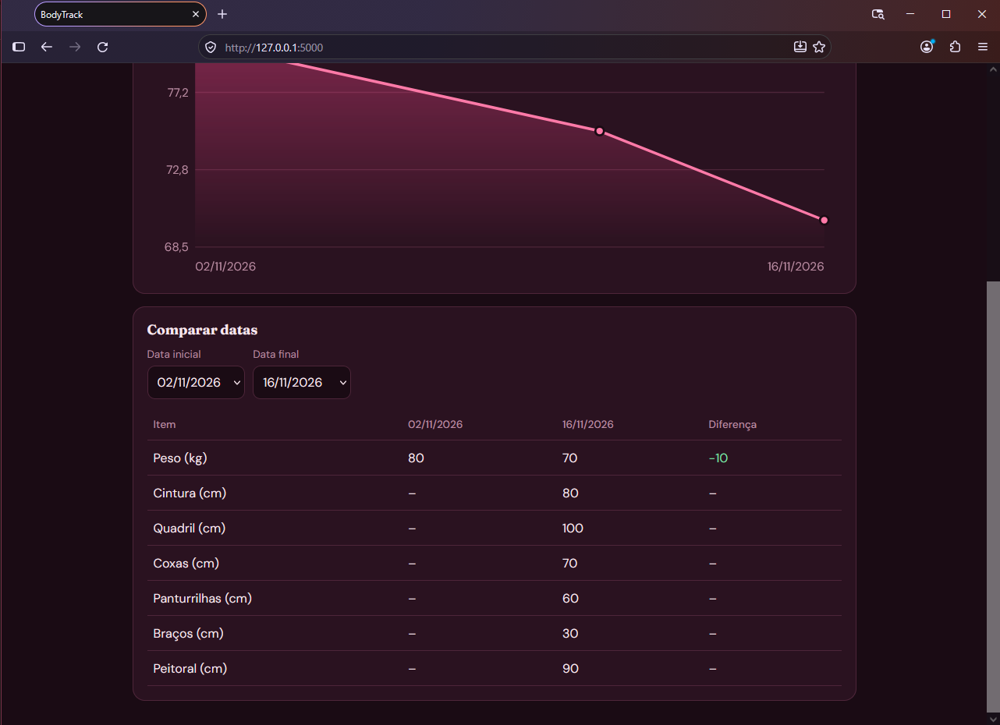

## 6. Perfil
Na aba **Perfil** você altera nome, e-mail, data de nascimento e senha. O botão **Excluir minha conta** apaga a conta e todos os registros (pede confirmação).

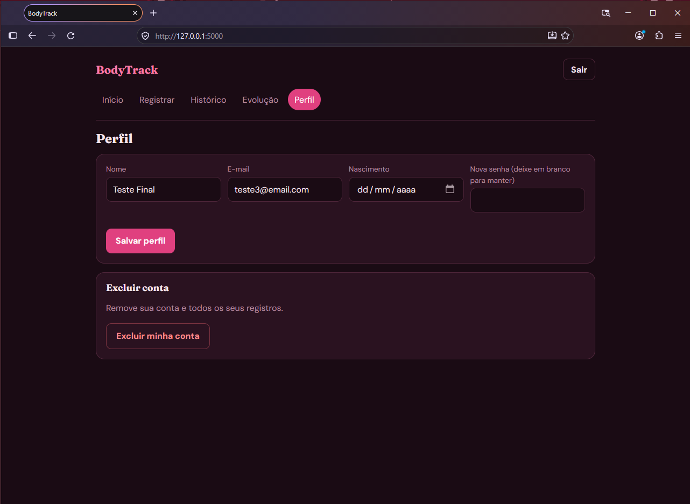

## 7. Uso no celular
O app se adapta à tela: no celular o menu fica na parte de baixo.

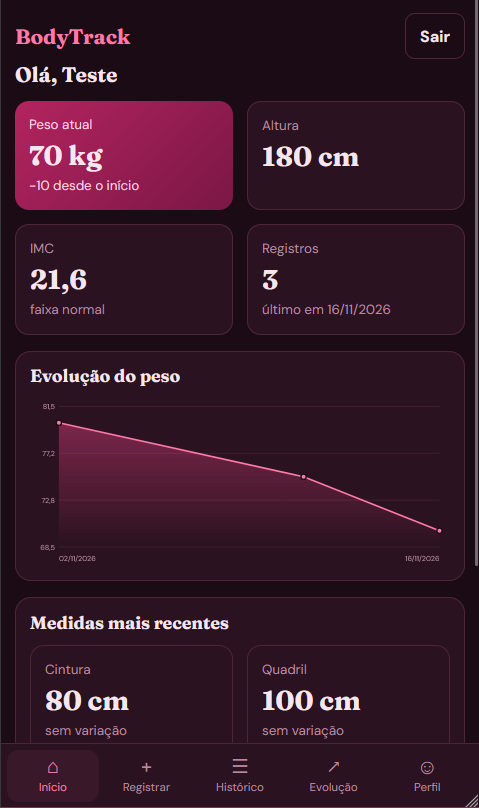
